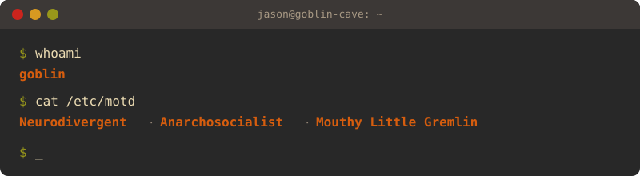

<!-- |========| Header |========| -->

---

<!-- |========| Dev Profiler |========| -->

<h2 align="center">Dev Profiler</h2>

<strong>./src/routes/+page.svelte</strong>

<pre>
<code>&lt;script lang="ts"&gt;
  import { getProfile } from "#lib/profile.remote.ts";
  import { START, step, type Phase, type Role } from "#lib/domain.ts";

  const profile = await getProfile();
  const [current, ...past] = profile.roles;

  let phase = $state&lt;Phase&gt;(START);
  const next = $derived(step(profile.loop, phase));

  $effect(() =&gt; {
    const then = next;
    if (then === undefined) return;
    const t = setTimeout(() =&gt; (phase = then), 4000);
    return () =&gt; clearTimeout(t);
  });
&lt;/script&gt;

{#snippet tenure({ role, org, from, to }: Role)}
  &lt;li&gt;{role} at {org}, {from} to {to ?? "now"}&lt;/li&gt;
{/snippet}

&lt;h1&gt;{profile.name} is a {profile.desc}&lt;/h1&gt;

{#if profile.species === "goblin"}
  &lt;p&gt;now: {phase}&lt;/p&gt;
  &lt;p&gt;next: {next}&lt;/p&gt;
  &lt;p&gt;and after rebuilding? {profile.loop.rebuilding}&lt;/p&gt;
{:else}
  &lt;p&gt;now: {phase}&lt;/p&gt;
  &lt;p&gt;next: {next ?? "nothing. they shipped."}&lt;/p&gt;
{/if}

&lt;ul&gt;
  {@render tenure(current)}
  {#each past as role (`${role.org}/${role.role}/${role.from}`)}
    {@render tenure(role)}
  {/each}
&lt;/ul&gt;</code>
</pre>

<strong>./src/lib/profile.remote.ts</strong>

<pre>
<code>import { prerender } from "$app/server";
import { describe } from "#lib/describe.ts";
import type { AnyProfile } from "#lib/domain.ts";
import { jason } from "#db/facts.ts";

export const getProfile = prerender(async (): Promise&lt;AnyProfile&gt; =&gt; describe(jason));</code>
</pre>

<strong>./src/lib/describe.ts</strong>

<pre>
<code>import { LOOP, type AnyProfile, type Being, type Profile } from "./domain.ts";
import { roles } from "#db/facts.ts";

function isJason(being: Being): being is Being &amp; { readonly name: "Jason" } {
  return being.name === "Jason";
}

export function describe(being: Being &amp; { readonly name: "Jason" }): Profile&lt;"goblin"&gt;;
export function describe(being: Being): Profile&lt;"human"&gt;;
export function describe(being: Being): AnyProfile {
  if (isJason(being)) {
    return {
      ...being,
      species: "goblin",
      desc: "neurodivergent anarchosocialist goblin",
      roles: roles.jason,
      loop: LOOP.goblin,
    };
  }

  return {
    ...being,
    species: "human",
    desc: "pro fullstack dev",
    roles: roles.anyone,
    loop: LOOP.human,
  };
}</code>
</pre>

<strong>./src/lib/domain.ts</strong>

<pre>
<code>// ---- primitives

type Digit = 0 | 1 | 2 | 3 | 4 | 5 | 6 | 7 | 8 | 9;
type Month = `0${Exclude&lt;Digit, 0&gt;}` | "10" | "11" | "12";
export type YearMonth = `${number}-${Month}`;
export type Handle = `@${string}`;

// ---- roles

interface Tenure {
  readonly org: Handle;
  readonly role: string;
  readonly level?: string;
  readonly from: YearMonth;
}
export type CurrentRole = Tenure &amp; { readonly to?: never };
export type PastRole = Tenure &amp; { readonly to: YearMonth };
export type Role = CurrentRole | PastRole;
export type Timeline = readonly [CurrentRole, ...PastRole[]];

// ---- species

export type Species = "human" | "goblin";

type Adjective&lt;S extends Species&gt; = S extends "goblin"
  ? "neurodivergent" | "anarchosocialist"
  : "pro" | "fullstack";
type Noun&lt;S extends Species&gt; = S extends "goblin" ? "goblin" : "dev";
type Pair&lt;A extends string, B extends string = A&gt; = A extends unknown
  ? `${A} ${Exclude&lt;B, A&gt;}`
  : never;
export type Desc&lt;S extends Species&gt; = `${Pair&lt;Adjective&lt;S&gt;&gt;} ${Noun&lt;S&gt;}`;

export interface Being {
  readonly name: string;
  readonly handle: Handle;
  readonly stack: readonly string[];
}

// ---- the loop

export type Phase =
  | "fixing a small thing"
  | "questioning the foundations"
  | "rebuilding"
  | "shipped";

export const LOOP = {
  goblin: {
    "fixing a small thing": "questioning the foundations",
    "questioning the foundations": "rebuilding",
    rebuilding: "fixing a small thing",
  },
  human: {
    "fixing a small thing": "shipped",
  },
} as const satisfies { readonly [S in Species]: { readonly [P in Phase]?: Phase } };

export const START = "fixing a small thing" satisfies Phase;

export type Machine&lt;S extends Species&gt; = (typeof LOOP)[S];
export const step = (machine: Partial&lt;Record&lt;Phase, Phase&gt;&gt;, phase: Phase) =&gt; machine[phase];
export type Next&lt;S extends Species, P extends Phase&gt; = P extends keyof Machine&lt;S&gt;
  ? Machine&lt;S&gt;[P]
  : never;

// ---- profile

export interface Profile&lt;S extends Species = Species&gt; extends Being {
  readonly species: S;
  readonly desc: Desc&lt;S&gt;;
  readonly roles: Timeline;
  readonly loop: Machine&lt;S&gt;;
}
export type AnyProfile = { [S in Species]: Profile&lt;S&gt; }[Species];</code>
</pre>

<strong>./db/facts.ts</strong>

<pre>
<code>import type { Being, Timeline } from "#lib/domain.ts";

export const jason = {
  name: "Jason",
  handle: "@JasonWarrenUK",
  stack: ["svelte", "bun", "go", "python", "claude"],
} as const satisfies Being;

export const roles = {
  jason: [
    { org: "@TandemCreativeDev", role: "developer", from: "2026-06" },
    { org: "@foundersandcoders", role: "apprentice dev", level: "mid/senior (shhh)", from: "2025-01", to: "2026-06" },
    { org: "@foundersandcoders", role: "L6 AI apprenticeship mentor", from: "2025-01", to: "2026-06" },
    { org: "@FAC-31", role: "facilitator", from: "2025-02", to: "2025-07" },
    { org: "@foundersandcoders", role: "dev", from: "2024-09", to: "2025-01" },
    { org: "@fac30", role: "grad", from: "2024-09", to: "2024-12" },
    { org: "@FAC29A", role: "grad", from: "2023-09", to: "2023-11" },
  ],
  anyone: [
    { org: "@techStartUp", role: "innovation engineer", from: "2024-01" },
  ],
} as const satisfies { readonly [who: string]: Timeline };</code>
</pre>

<strong>./src/lib/describe.test.ts</strong>

<pre>
<code>import { suite, test, expect, expectTypeOf } from "vitest";
import { describe } from "./describe.ts";
import { jason } from "#db/facts.ts";
import type { Profile } from "./domain.ts";

suite("the compiler knows", () =&gt; {
  test("jason is a goblin", () =&gt; {
    const profile = describe(jason);
    expectTypeOf(profile).toEqualTypeOf&lt;Profile&lt;"goblin"&gt;&gt;();
    expect(profile.desc).toBe("neurodivergent anarchosocialist goblin");
  });

  test("everyone else is a professional", () =&gt; {
    const profile = describe({ name: "Dave", handle: "@dave", stack: ["react"] });
    expectTypeOf(profile).toEqualTypeOf&lt;Profile&lt;"human"&gt;&gt;();
    expect(profile.loop["fixing a small thing"]).toBe("shipped");
  });

  test("there is no promotion out of goblin", () =&gt; {
    // @ts-expect-error Type '"goblin"' is not assignable to type '"human"'
    const pro: Profile&lt;"human"&gt; = describe(jason);
    expect(pro.species).toBe("goblin");
  });
});</code>
</pre>

---

<h2 align="center">The Debris Left in My Wake</h2>

<strong>On Fire Right Now</strong>

<em>what's eating my evenings</em>

<table align="left">
<tr>
<th></th>
<th>Name</th>
<th>Description</th>
<th>Links</th>
</tr>
<tr>
<td>🏔️</td>
<td><strong>Urheimat</strong></td>
<td>lead a people across the ages, then watch future scholars try to reconstruct what you actually believed</td>
<td><a href="https://urheimat.vercel.app">site</a> / <a href="https://github.com/JasonWarrenUK/urheimat">repo</a></td>
</tr>
<tr>
<td>🌊</td>
<td><strong>CHIRPdb</strong></td>
<td>ingest maritime incident reports & serve them as a structured API</td>
<td><a href="https://zigzag-technology.github.io/CHIRPdb-Documentation/">docs</a> / <a href="https://github.com/ZigZag-Technology">org</a></td>
</tr>
<tr>
<td>🧭</td>
<td><strong>Drift</strong></td>
<td>a CLI that fingerprints every repo a portfolio claims, plus the SvelteKit site it keeps honest</td>
<td><a href="https://jason-warren.vercel.app">site</a> / <a href="https://github.com/JasonWarrenUK/jason-warren">repo</a></td>
</tr>
<tr>
<td>✒️</td>
<td><strong>The Work</strong></td>
<td>write a thesis in one night whilst staving off existential angst</td>
<td><a href="https://jasonwarrenuk.github.io/the-work/">site</a> / <a href="https://github.com/JasonWarrenUK/the-work">repo</a></td>
</tr>
<tr>
<td>👹</td>
<td><strong>Goblin Mode</strong></td>
<td>three goblins in a trenchcoat pretending to be a senior developer: Claude Code config shaped by ADHD, friction & spite</td>
<td><a href="https://github.com/JasonWarrenUK/goblin-mode">repo</a></td>
</tr>
<tr>
<td>🗺️</td>
<td><strong>Historia</strong></td>
<td>watch Britain's kingdoms shift across an animated map from 300 to 1066 CE</td>
<td><a href="https://historia-opal.vercel.app">site</a> / <a href="https://github.com/JasonWarrenUK/historia">repo</a></td>
</tr>
</table>

<strong>Receipts</strong>

<em>shipped, used by actual humans</em>

<table align="left">
<tr>
<th>Name</th>
<th>Description</th>
<th>Team</th>
<th>Year</th>
<th>Links</th>
</tr>
<tr>
<td><strong>Iris</strong></td>
<td>turn messy learner CSVs into validated ILR submissions that the ESFA will actually accept</td>
<td></td>
<td>2026</td>
<td><a href="https://github.com/foundersandcoders/iris">repo</a></td>
</tr>
<tr>
<td><strong>Michelle Guy</strong></td>
<td>a site for an acting coach who deserves better than a Squarespace template</td>
<td></td>
<td>2026</td>
<td><a href="https://michelle-guy.vercel.app">site</a> / <a href="https://github.com/JasonWarrenUK/michelle-guy">repo</a></td>
</tr>
<tr>
<td><strong>Schema Forge</strong></td>
<td>read XSD files & validate, map & generate the XML they describe</td>
<td></td>
<td>2026</td>
<td><a href="https://www.npmjs.com/package/@jasonwarrenuk/schema-forge">npm</a> / <a href="https://github.com/JasonWarrenUK/schema-forge">repo</a></td>
</tr>
<tr>
<td><strong>FAC Internal Platform</strong></td>
<td>the internal engine that keeps Founders and Coders running: API, apps & workers</td>
<td><a href="https://github.com/Jaz-spec">@Jaz-spec</a>, <a href="https://github.com/izaakrogan">@izaakrogan</a> & <a href="https://github.com/sofer">@sofer</a></td>
<td>2026</td>
<td></td>
</tr>
<tr>
<td><strong>Guardrails</strong></td>
<td>strip the PII out of your prompts before they ever reach an LLM</td>
<td>Ahmed Shatat, <a href="https://github.com/mohmmadAyesh">@mohmmadAyesh</a> & Erica Gasparini</td>
<td>2026</td>
<td><a href="https://github.com/yalla-coop">org</a></td>
</tr>
<tr>
<td><strong>Workwise</strong></td>
<td>turn static accessibility surveys into dynamic evolving conversations</td>
<td><a href="https://github.com/AlexVOiceover">@AlexVOiceover</a></td>
<td>2025</td>
<td><a href="https://github.com/foundersandcoders/workwise">repo</a></td>
</tr>
<tr>
<td><strong>Things We Do</strong></td>
<td>track your mood & build a personal toolkit for getting through the day</td>
<td><a href="https://github.com/jackcasstlesjones">@jackcasstlesjones</a>, <a href="https://github.com/maxitect">@maxitect</a> & <a href="https://github.com/gurtatiLND">@gurtatiLND</a></td>
<td>2024</td>
<td><a href="https://github.com/fac30/things-we-do">repo</a></td>
</tr>
<tr>
<td><strong>Sakura</strong></td>
<td>a colour palette app where you can ask for "dark reddish purple" & it knows what you mean</td>
<td><a href="https://github.com/jackcasstlesjones">@jackcasstlesjones</a> & <a href="https://github.com/JoshCodedit">@JoshCodedit</a></td>
<td>2024</td>
<td><a href="https://github.com/fac30/sakura-api">server</a> / <a href="https://github.com/fac30/sakura-front">client</a></td>
</tr>
</table>

<strong>Unreplied Texts</strong>

<em>the code exists; I walked away</em>

<table align="left">
<tr>
<th></th>
<th>Name</th>
<th>Description</th>
<th>Links</th>
</tr>
<tr>
<td>🌀</td>
<td><strong>Wyrd</strong></td>
<td>a terminal productivity system on a flat-file property graph: tasks, notes, habits & budgets, all connected</td>
<td><a href="https://github.com/JasonWarrenUK/wyrd">repo</a></td>
</tr>
<tr>
<td>🏛️</td>
<td><strong>Those Who Came Before</strong></td>
<td>try to understand a vanished culture by interpreting procedurally generated artefacts</td>
<td><a href="https://jasonwarrenuk.github.io/those-who-came-before/">site</a> / <a href="https://github.com/JasonWarrenUK/those-who-came-before">repo</a></td>
</tr>
<tr>
<td>🗣️</td>
<td><strong>The Tongue</strong></td>
<td>grow a proto-language, then watch it drift, spread & fracture into daughter tongues</td>
<td><a href="https://the-tongue.vercel.app">site</a> / <a href="https://github.com/JasonWarrenUK/the-tongue">repo</a></td>
</tr>
<tr>
<td>🗡️</td>
<td><strong>Bronze Remembers</strong></td>
<td>a turn-based tactics RPG with a legacy spine, built in Godot</td>
<td><a href="https://github.com/JasonWarrenUK/bronze-remembers">repo</a></td>
</tr>
<tr>
<td>⏳</td>
<td><strong>Grand Chronicle</strong></td>
<td>taking someone who witnessed a historical event & see what else they lived through</td>
<td><a href="https://epoch-tau.vercel.app">site</a> / <a href="https://github.com/JasonWarrenUK/epoch">repo</a></td>
</tr>
<tr>
<td>🧠</td>
<td><strong>Cogni</strong></td>
<td>map your cognitive style across 17 compasses & find the dev methodology that fits</td>
<td><a href="https://github.com/JasonWarrenUK/cogni">repo</a></td>
</tr>
<tr>
<td>🍳</td>
<td><strong>Kitchen Gremlin</strong></td>
<td>replace Paprika with something that does meal plans & shopping lists properly</td>
<td><a href="https://github.com/JasonWarrenUK/kitchen-gremlin">repo</a></td>
</tr>
<tr>
<td>🤖</td>
<td><strong>Rhea</strong></td>
<td>an LLM-powered assistant for democratic/peer-led learning cohorts</td>
<td><a href="https://github.com/foundersandcoders/rhea">repo</a></td>
</tr>
<tr>
<td>⚔️</td>
<td><strong>Flyt</strong></td>
<td>duel a Norseman through ritual insult poetry & defend your honour in verse</td>
<td><a href="https://flyt-delta.vercel.app">site</a> / <a href="https://github.com/JasonWarrenUK/flyt">repo</a></td>
</tr>
<tr>
<td>🔮</td>
<td><strong>Sparker</strong></td>
<td>track observations about SEN students over time & surface the patterns a facilitator might miss</td>
<td><a href="https://github.com/JasonWarrenUK/sparker">repo</a></td>
</tr>
<tr>
<td>🧵</td>
<td><strong>Beacons</strong></td>
<td>turn freeform journaling into a graph you can actually navigate & act on</td>
<td><a href="https://github.com/foundersandcoders/beacons-backend">server</a> / <a href="https://github.com/foundersandcoders/beacons-frontend-v2">client</a></td>
</tr>
</table>

<strong>Odd Socks</strong>

<em>toys, experiments & things built for one person</em>

<table align="left">
<tr>
<th>Name</th>
<th>Links</th>
<th>Team</th>
<th>Year</th>
</tr>
<tr>
<td><strong>Quiz Night</strong></td>
<td><a href="https://github.com/JasonWarrenUK/quiz">repo</a></td>
<td></td>
<td>2026</td>
</tr>
<tr>
<td><strong>Reach</strong></td>
<td><a href="https://reach-phi-five.vercel.app">site</a> / <a href="https://github.com/JasonWarrenUK/reach">repo</a></td>
<td></td>
<td>2026</td>
</tr>
<tr>
<td><strong>Explainers</strong></td>
<td><a href="https://explainers-eta.vercel.app">site</a> / <a href="https://github.com/JasonWarrenUK/explainers">repo</a></td>
<td></td>
<td>2026</td>
</tr>
<tr>
<td><strong>Tallywhack</strong></td>
<td><a href="https://github.com/JasonWarrenUK/tallywhack">repo</a></td>
<td></td>
<td>2026</td>
</tr>
<tr>
<td><strong>The World I'd Build You</strong></td>
<td><a href="https://the-world-id-build-you.vercel.app">site</a> / <a href="https://github.com/JasonWarrenUK/lyra-rose">repo</a></td>
<td></td>
<td>2026</td>
</tr>
<tr>
<td><strong>Grumble</strong></td>
<td><a href="https://grumble-azure.vercel.app">site</a> / <a href="https://github.com/JasonWarrenUK/grumble">repo</a></td>
<td></td>
<td>2026</td>
</tr>
<tr>
<td><strong>Top Girls</strong></td>
<td><a href="https://top-girls.vercel.app">site</a> / <a href="https://github.com/JasonWarrenUK/top-girls">repo</a></td>
<td></td>
<td>2026</td>
</tr>
<tr>
<td><strong>Code Arcana</strong></td>
<td><a href="https://github.com/JasonWarrenUK/code-arcana">repo</a></td>
<td></td>
<td>2026</td>
</tr>
<tr>
<td><strong>Rimewarden</strong></td>
<td><a href="https://github.com/JasonWarrenUK/rimewarden">repo</a></td>
<td></td>
<td>2026</td>
</tr>
<tr>
<td><strong>Baby Names</strong></td>
<td><a href="https://github.com/JasonWarrenUK/baby-names">repo</a></td>
<td></td>
<td>2026</td>
</tr>
<tr>
<td><strong>Sith Maker</strong></td>
<td><a href="https://github.com/JasonWarrenUK/sith-maker">repo</a></td>
<td></td>
<td>2026</td>
</tr>
<tr>
<td><strong>Nihilistic Onboarder</strong></td>
<td><a href="https://github.com/JasonWarrenUK/nihilistic-onboarder">repo</a></td>
<td></td>
<td>2025</td>
</tr>
<tr>
<td><strong>Hat Recommender</strong></td>
<td><a href="https://github.com/JasonWarrenUK/telebrain">repo</a></td>
<td></td>
<td>2025</td>
</tr>
<tr>
<td><strong>Psyche</strong></td>
<td><a href="https://github.com/fac-31/psyche">repo</a></td>
<td><a href="https://github.com/Jaz-spec">@Jaz-spec</a></td>
<td>2025</td>
</tr>
<tr>
<td><strong>Commons Traybake</strong></td>
<td><a href="https://github.com/fac-31/commons-traybake">repo</a></td>
<td><a href="https://github.com/Jaz-spec">@Jaz-spec</a>, <a href="https://github.com/nchua3012">@nchua3012</a> & <a href="https://github.com/JosephPotashnik">@JosephPotashnik</a></td>
<td>2025</td>
</tr>
<tr>
<td><strong>ReDoT</strong></td>
<td><a href="https://github.com/fac-31/ReDoT">repo</a></td>
<td><a href="https://github.com/JosephPotashnik">@JosephPotashnik</a> & <a href="https://github.com/FortyTwoFortyTwo">@FortyTwoFortyTwo</a></td>
<td>2025</td>
</tr>
<tr>
<td><strong>The Forgotten One</strong></td>
<td><a href="https://github.com/JasonWarrenUK/the-forgotten-one">repo</a></td>
<td></td>
<td>2025</td>
</tr>
<tr>
<td><strong>Petulant God</strong></td>
<td><a href="https://github.com/JasonWarrenUK/petulant-god">repo</a></td>
<td></td>
<td>2023</td>
</tr>
<tr>
<td><strong>Melonhead</strong></td>
<td><a href="https://neurosocialist.itch.io/melonhead">itch.io</a></td>
<td></td>
<td>2022</td>
</tr>
<tr>
<td><strong>Prisms</strong></td>
<td><a href="https://neurosocialist.itch.io/prisms">itch.io</a> / <a href="https://github.com/JasonWarrenUK/prisms">repo</a></td>
<td></td>
<td>2021</td>
</tr>
<tr>
<td><strong>My Brothers, Counting</strong></td>
<td><a href="https://neurosocialist.itch.io/brothers-trying-to-count">itch.io</a></td>
<td></td>
<td>2020</td>
</tr>
</table>

---

<h2 align="center">Hit Me Up</h2>

---

<h2 align="center">Field Guide to Jason</h2>

<strong>How Does It Behave?</strong>

<h4 align="left"><s>I Need Help</s>Collaboration Opportunities</h4>

<ul>
<li>I'm looking to collaborate on <strong>useless-yet-interesting linguistics utilities & neurodivergent revolutionary digital infrastructure</strong></li>
<li>I'm looking for help with <strong>basic life skills</strong></li>
</ul>

<h4 align="left">Past Lives</h4>

<ul>
<li>Also I started by bimbling about with <a href="https://neurosocialist.itch.io/">ink stories</a></li>
<li>I wroted a book: <a href="https://amazon.co.uk/Creating-Worlds-Immersive-Theatre-Making/dp/1848424450">here it is</a></li>
</ul>

<h4 align="left">Trivia</h4>

<ul>
<li>Ask me about <strong>arts pedagogy & interactive narrative</strong></li>
<li>How to reach me: <strong><s>gently, and with a kind smile</s> contact.jwarren@gmail.com</strong></li>
<li>Fun Fact: <strong>There is no ethical consumption under late-stage capitalism</strong></li>
</ul>

<strong>What Is It Doing?</strong>

Daily drivers: <strong>TypeScript</strong>, <strong>Svelte</strong>, <strong>Bun</strong> & <strong>Python</strong>. I also build the agent tooling that the AI works inside: skills, hooks, subagents & orchestration workflows for Claude Code (see <a href="https://github.com/JasonWarrenUK/goblin-mode">Goblin Mode</a>).

I'm currently seriously learning about...

<ul>
<li><strong>Go</strong> (<em>Bubbletea & friends, via Wyrd</em>)</li>
<li><strong>Godot</strong> & <strong>GDScript</strong> (<em>via Bronze Remembers</em>)</li>
<li><strong>pgvector</strong> & <strong>semantic search</strong> (<em>via CHIRPdb</em>)</li>
</ul>

I'm also dabbling with...

<ul>
<li><strong>Obsidian plugins</strong></li>
<li><strong>Docker</strong></li>
</ul>

---

<h2 align="center">is rl dev, look</h2>

 

 

<footer>
</footer>
